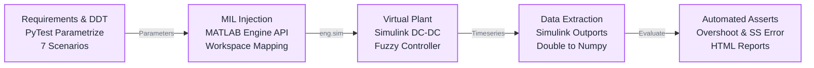

# DC-DC Fuzzy Control MIL Automation Test Framework Based on Pytest and Simulink

This is a local **automation test platform** designed to transform the traditional verification of **power electronics** control algorithms into reproducible automated test cases based on  **model-in-the-loop (MIL)** methodologies, with the tools of **Pytest** and **MATLAB/Simulink**.

> **Skills shown:** firmware test automation (Python/pytest) · MIL (Model-in-the-Loop) · cross-language scheduling (MATLAB Engine API) · data-driven testing (DDT) · Simulink modeling · fuzzy logic control (FLC) · power electronics (DC-DC converter) · boundary condition verification · telemetry data analysis (Numpy/Pandas) · automated test assertions

## How it fits together



## Why this project exists

This project is designed to demonstrate core competencies for **Automation Firmware Test Engineer / Firmware Test Engineer** roles. It focuses on three connected responsibilities:
1. Translating control algorithms and electrical specifications into testable requirements and automated acceptance criteria;
2. Automating a software-model complex at the MIL (Model-in-the-Loop) level via cross-language scheduling (Python & MATLAB);
3. Executing nominal, boundary, and transient-disturbance scenarios without manual intervention, exporting verifiable test evidence.

This repository demonstrates that full automation chain in a compact, local virtual lab.

## What is implemented

### Virtual MIL Bench (Python-MATLAB Co-Simulation)
* Data-Driven Testing (DDT) engine via PyTest;
* MATLAB Engine API lifecycle management and session reuse;
* Dynamic Simulink workspace parameter injection;
* Automated execution of `sim()` solver commands;
* Time-series telemetry data extraction (Double array parsing);
* Automated simulation timeout and exception handling mechanisms.

### System under test (SUT)
Reference DC-DC Buck Converter equipped with a **Fuzzy Logic Controller (FLC)**.
Observable variables and control metrics include:
* `Vin` (Input source voltage)
* `Vout` (Regulated output voltage)
* `I_L` (Inductor current)
* `Load_R` (Load resistance)
* `E` & `EC` (Fuzzy logic inputs: Voltage Error and Error Change Rate)

## Regression matrix

The initial release contains executable MIL scenarios covering various operational conditions:

| Scenario | Purpose |
| :--- | :--- |
| `nominal_steady_state` | Nominal input voltage and load baseline regulation |
| `load_transient_step_up` | FLC robustness against sudden load resistance increase |
| `load_transient_step_down` | FLC recovery during sudden load resistance decrease |
| `input_voltage_sag` | Boundary verification: simulating input source voltage drop |
| `input_voltage_surge` | Boundary verification: simulating source overvoltage |
| `fuzzy_rule_extreme` | Extreme initial error states to stress the fuzzy rule base |
| `engine_timeout_recovery` | Fault tolerance: PyTest reruns upon MATLAB engine blocking |

*The Python test execution scripts run all scenarios automatically and export visual/HTML evidence.*

## Measured acceptance metrics

Instead of manual waveform observation, each automated run programmatically evaluates:
* **Maximum Overshoot (%)**: Ensuring voltage spikes remain within safety thresholds;
* **Settling Time (s)**: Measuring the controller's dynamic response speed;
* **Steady-state Error (V)**: Validating long-term voltage regulation accuracy;
* **Peak Time (s)**: Analyzing the transient state characteristics;
* **Pass/Fail Booleans**: Strict `pytest assert` validation against predefined electrical spec limits.

## Environment & Dependencies

This project uses Conda for virtual environment management. The core runtime environment consists of **Python 3.10** and **MATLAB R2024b**.

### Core Python dependencies

**1. Engine & API**
* `matlabengine (24.2.2)`: The official Python API provided by MATLAB, designed to enable cross-language background scheduling and lifecycle management of Simulink models from Python.

**2. Testing Framework**
* `pytest (9.1.1)`: Core test-driven framework, supporting batch scenario injection based on data-driven testing (DDT).
* `pytest-html (4.2.0)`: Used to automatically generate a visual test report—containing key electrical metrics such as overshoot and settling time—upon completion of test execution.
* `pytest-rerunfailures (16.7)`: Provides an automated retry and fault-tolerance mechanism for cases where a simulation times out or the engine is unexpectedly interrupted.
* `pytest-xdist (3.8.0)`: (Reserved) For distributed or concurrent scheduling of test tasks.

**3. Data Processing**
* `numpy (2.2.5)` & `pandas (2.3.3)`: Used for processing telemetry time-series data returned by Simulink, performing calculations for steady-state error and peak time, and executing automated assertions.
* `matplotlib (3.10.9)`: Used for plotting and outputting step response.

### Instructions for Environment Reproduction

You can restore the development environment in one step using the `environment.yml` file provided in the repository:
```bash
conda env create -f environment.yml
conda activate py310
```

## Data Flow Architecture

### 1. Data Preparation -> Python
* **Workflow**: `test_data.py` -> `pytest.mark.parametrize`
* **Mechanism**: Python reads a pre-defined matrix of test scenarios. These scenarios encompass parameters such as the initial rule weights of the fuzzy controller, setpoint values ​​for sudden input voltage changes, and the timing of load resistance shifts. The parameterization mechanism in Pytest then deconstructs this matrix into individual test cases.

### 2. Parameter Injection -> Python to MATLAB
* **Workflow**: Python variables → `matlabengine` → MATLAB Base Workspace
* **Mechanism**: Using the MATLAB Engine API, Python injects the parameters of the current test instance (such as `Kp`, `Ki`, `Load_R`, etc.) into the MATLAB Base Workspace as key-value pairs. This process facilitates the transfer of test parameters from Python memory into MATLAB memory.

### 3. Simulation Execution -> MATLAB to Simulink
* **Workflow**: MATLAB Workspace -> `sim()` function -> Simulink Model
* **Mechanism**: Python issues an execution command (e.g., `eng.sim('DC_DC_Buck_Fuzzy')`). The Simulink model launches and automatically retrieves the fuzzy control parameters and hardware operating conditions—which have just been injected into the Workspace—to perform its computations.

### 4. Data Extraction -> Simulink to Python
* **Workflow**: Simulink Outport → MATLAB Workspace → `matlabengine` → Python
* **Mechanism**: Upon completion of the simulation, Simulink exports key time-series data—such as output voltage and inductor current—to the MATLAB workspace. Python then regains control via the engine API, retrieves these arrays (of type `double`) into its own memory, and converts them into NumPy/Pandas formats for further processing.

### 5. Assertion & Visualization -> Python
* **Workflow**: Raw data array → Core algorithmic computation → Pytest `assert` / Matplotlib
* **Mechanism**: A Python script processes the returned voltage waveforms and automatically calculates three key electrical parameters: **Overshoot**, **Settling Time**, and **Steady-state Error**.
  * The calculated results are compared against predefined thresholds using `assert` statements to determine whether a test case passes or fails.
  * Matplotlib is triggered to plot the step response curve for the current operating condition, with the resulting plot integrated into the test report (`pytest-html`).

## Repository layout

```text
.
├── models/                               Simulink models (DC_DC_Buck_Fuzzy.slx) and MATLAB init scripts
├── src/                                  Folder for Matlab scripts and python api
│   └── matlab_engine_api.py              Matlab engine api to boost Matlab and Simulink
├── tests/                                PyTest execution scripts, DDT fixtures, and assertion logic
│   ├── test_data.py                      Test matrix and boundary conditions configurations
│   └── test_test_buck_robustness.py      Core test execution and metric evaluation logic
├── test_reports/                         Generated regression evidence (Matplotlib plots)
├── environment.yml                       Conda environment dependencies (Python 3.10)
├── pytest.ini                            Pytest configuration
├── main.py                               Main python file to boost Pytest tests
└── README.md                             Architecture, test strategy, and data flow documentation
```

## Honest scope: what this proves and what it does not

**Demonstrated in code and tests**
* Python-driven automation design and Data-Driven Testing (DDT);
* Cross-language system integration (Python & MATLAB R2024b);
* Deterministic MIL-style simulation workflow;
* Automated telemetry data extraction from physical solvers;
* Algorithmic evaluation of electrical metrics (Overshoot, Settling Time, SS Error);
* Requirement traceability through parameterized test matrices;
* Nominal, boundary, and transient-disturbance fault testing;
* Structured visual and HTML run evidence;
* PyTest ecosystem utilization (assertions, fixtures, xdist, rerunfailures).

**Not claimed**
* Access to physical DC-DC Buck converter hardware or prototype boards;
* Work on real-time HIL simulator racks (e.g., OPAL-RT, Typhoon HIL, dSPACE, NI);
* Real physical instrument control (e.g., PyVISA communicating with real oscilloscopes or programmable power supplies);
* C/C++ firmware deployment to actual embedded microcontrollers (DSP/MCU).

That distinction is intentional. The repository is designed as a reproducible engineering portfolio lab. The next integration step—swapping the MATLAB Engine API for hardware interfaces (like PyVISA or HIL APIs)—is explicit, structured, and ready for deployment rather than hidden behind mocked claims. 

## Version
v1.0.0 — Initial MIL test file release.